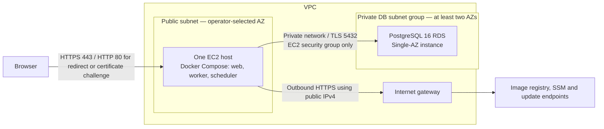

# AWS reference topology

This directory defines the AWS-01 input interface and selected architecture. It contains **no resources, data sources, AWS provider or backend**. It does not provision an environment. Resource implementations belong to AWS-02 through AWS-09; the production-container smoke prerequisite is DOCKER-04 (#17).



One EC2 host runs the web, worker and scheduler containers. PHP-FPM, PostgreSQL, Redis and management ports stay private. Use SSM for administration; SSH is not a required public entry point. Redis remains optional and off by default; sessions and queues retain their database drivers. A container restart policy is not host or AZ redundancy.

The EC2 public subnet has an internet-gateway route and the instance has a public IPv4 address. This permits image pulls, SSM connectivity and package updates without a mandatory NAT Gateway. It does not authorize unrestricted inbound traffic. Restrict security groups and outbound access in AWS-03 (#24). ALB, ECS, Fargate and Kubernetes are outside this initial topology. See [internet-gateway requirements](https://docs.aws.amazon.com/vpc/latest/userguide/VPC_Internet_Gateway.html).

RDS has no public access. Its security group accepts PostgreSQL only from the EC2 security group in the VPC. Even Single-AZ RDS requires a DB subnet group covering at least two AZs; that group does **not** make the database Multi-AZ. Database credentials, TLS verification and a non-administrative application role belong to AWS-05/AWS-06. See [RDS VPC and subnet requirements](https://docs.aws.amazon.com/AmazonRDS/latest/UserGuide/USER_VPC.WorkingWithRDSInstanceinaVPC.html).

## Operator choices and limits

Every variable in `variables.tf` is required; there are no region, instance, domain, capacity or budget defaults. `terraform.tfvars.json.example` is an intentionally incomplete placeholder, never an automatic variable file. Replace every placeholder and `null` capacity/recovery field deliberately. `cost_review.monthly_budget` may remain `null` to record that no ceiling has been approved; this does not mean zero cost and creates no AWS Budget. Enter no credentials, application keys or secret values here.

Input validation checks basic shapes, positive capacities, explicit recovery objectives and nonzero backup retention. It does not check AWS service availability, instance compatibility, AMI minimum volume size, RDS storage limits, CIDR containment/overlap, DNS ownership or affordability. Resource-specific validation follows in the corresponding issues. Synthetic test values are not deployable recommendations.

The host is a single point of failure for web, jobs and schedules. Single-AZ RDS has no standby failover; host or AZ incidents and database maintenance can cause downtime. The operator must accept these limits or commission a separate availability design. See [Multi-AZ standby behavior](https://docs.aws.amazon.com/AmazonRDS/latest/UserGuide/Concepts.MultiAZSingleStandby.html).

Before any deployment, review regional EC2, EBS and snapshots, RDS compute/storage/I/O/backups, public IPv4, registry storage, data transfer (including possible cross-AZ traffic), logs and secret-management costs. No price, workload fit or free-tier eligibility is assumed. Public IPv4 has a charge; avoiding NAT does not make networking free. Use the selected region and approved workload to calculate costs and record an owner/ceiling. See [VPC pricing](https://aws.amazon.com/vpc/pricing/).

## Recovery requirements

Choose automated-backup retention explicitly (1–35 days), RPO, RTO and the cadence of isolated restore rehearsals. Backups do not provide availability and the targets in this interface are not measured guarantees. A restore creates a new RDS instance; verify private networking, encryption, TLS, schema/data, application-role access and web/worker/scheduler recovery before an explicitly approved cutover. Also account for application-key/secret recovery and persistent file data separately from database backups. AWS-09 (#30) supplies the operational procedure and evidence. No restore is performed here. See [backup retention](https://docs.aws.amazon.com/AmazonRDS/latest/UserGuide/USER_WorkingWithAutomatedBackups.BackupRetention.html) and [snapshot restore semantics](https://docs.aws.amazon.com/AmazonRDS/latest/UserGuide/USER_RestoreFromSnapshot.html).

## Offline validation

With Terraform 1.10 or later (below 2.0), from the repository root:

```sh
terraform -chdir=infra/aws fmt -check -recursive
terraform -chdir=infra/aws init -backend=false -input=false
terraform -chdir=infra/aws validate
terraform -chdir=infra/aws test
```

All test runs explicitly use `command = plan`; the current contract has no provider or resources, requires no AWS credentials and makes no AWS requests. Terraform tests otherwise default to `apply`, so preserve the explicit plan-only boundary when extending them. These checks validate the reference interface, not live infrastructure or backups. See [Terraform test commands](https://developer.hashicorp.com/terraform/language/tests).
