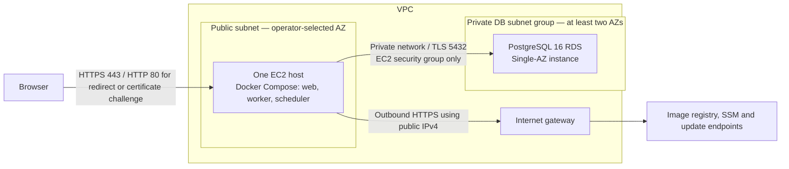

# AWS reference topology

This directory defines the AWS-01 input interface and selected architecture. The application root now defines the VPC, internet gateway, public/private subnets, route tables and restricted security groups with the locked AWS provider. It does not yet create EC2 or RDS. Its partial S3 backend is configured separately; the standalone `bootstrap/state-backend` root defines the reviewed bucket proposal. Neither offline validation nor application setup provisions an environment. Resource implementations belong to AWS-02 through AWS-09; the production-container smoke prerequisite is DOCKER-04 (#17).



One EC2 host runs the web, worker and scheduler containers. PHP-FPM, PostgreSQL, Redis and management ports stay private. Use SSM for administration; SSH is not a required public entry point. Redis remains optional and off by default; sessions and queues retain their database drivers. A container restart policy is not host or AZ redundancy.

The EC2 public subnet has an internet-gateway route and the instance has a public IPv4 address. This permits image pulls, SSM connectivity and package updates without a mandatory NAT Gateway. It does not authorize unrestricted inbound traffic. The web SG accepts HTTPS only from required `web_ingress_ipv4_cidrs`; `enable_http_ingress` defaults to false and enables only port 80 for a later redirect/challenge implementation. No SSH, Redis, FPM or administrative ingress exists. Web egress is TCP 80/443 for registry, SSM and package endpoints plus TCP 5432 to the database SG. The database SG has no initiated outbound rules; stateful responses remain permitted. VPC DNS resolver traffic is handled by AWS and cannot be filtered with SG rules. The default SG is emptied. ALB, ECS, Fargate and Kubernetes are outside this initial topology. See [internet-gateway requirements](https://docs.aws.amazon.com/vpc/latest/userguide/VPC_Internet_Gateway.html).

RDS has no public access. Its security group accepts PostgreSQL only from the EC2 security group in the VPC. Even Single-AZ RDS requires a DB subnet group covering at least two AZs; that group does **not** make the database Multi-AZ. Database credentials, TLS verification and a non-administrative application role belong to AWS-05/AWS-06. See [RDS VPC and subnet requirements](https://docs.aws.amazon.com/AmazonRDS/latest/UserGuide/USER_VPC.WorkingWithRDSInstanceinaVPC.html).

## Operator choices and limits

Region, domain, capacity, recovery and client CIDRs are required; only the HTTP ingress opt-in defaults to false; there are no region, instance, domain, capacity or budget defaults. `terraform.tfvars.json.example` is an intentionally incomplete placeholder, never an automatic variable file. Replace every placeholder and `null` capacity/recovery field deliberately. `cost_review.monthly_budget` may remain `null` to record that no ceiling has been approved; this does not mean zero cost and creates no AWS Budget. Enter no credentials, application keys or secret values here.

Input validation checks IPv4 prefix limits, subnet containment and overlap, basic shapes, positive capacities, explicit recovery objectives and nonzero backup retention. It does not check AWS service availability, instance compatibility, AMI minimum volume size, RDS storage limits, DNS ownership or affordability. Resource-specific validation follows in the corresponding issues. Synthetic test values are not deployable recommendations.

The host is a single point of failure for web, jobs and schedules. Single-AZ RDS has no standby failover; host or AZ incidents and database maintenance can cause downtime. The operator must accept these limits or commission a separate availability design. See [Multi-AZ standby behavior](https://docs.aws.amazon.com/AmazonRDS/latest/UserGuide/Concepts.MultiAZSingleStandby.html).

Before any deployment, review regional EC2, EBS and snapshots, RDS compute/storage/I/O/backups, public IPv4, registry storage, data transfer (including possible cross-AZ traffic), logs and secret-management costs. No price, workload fit or free-tier eligibility is assumed. Public IPv4 has a charge; avoiding NAT does not make networking free. Use the selected region and approved workload to calculate costs and record an owner/ceiling. See [VPC pricing](https://aws.amazon.com/vpc/pricing/).

## Recovery requirements

Choose automated-backup retention explicitly (1–35 days), RPO, RTO and the cadence of isolated restore rehearsals. Backups do not provide availability and the targets in this interface are not measured guarantees. A restore creates a new RDS instance; verify private networking, encryption, TLS, schema/data, application-role access and web/worker/scheduler recovery before an explicitly approved cutover. Also account for application-key/secret recovery and persistent file data separately from database backups. AWS-09 (#30) supplies the operational procedure and evidence. No restore is performed here. See [backup retention](https://docs.aws.amazon.com/AmazonRDS/latest/UserGuide/USER_WorkingWithAutomatedBackups.BackupRetention.html) and [snapshot restore semantics](https://docs.aws.amazon.com/AmazonRDS/latest/UserGuide/USER_RestoreFromSnapshot.html).

## Offline validation

With Terraform 1.10 or later (below 2.0), from the repository root:

```sh
terraform -chdir=infra/aws fmt -check -recursive
terraform -chdir=infra/aws init -backend=false -input=false
terraform -chdir=infra/aws validate
terraform -chdir=infra/aws test
```

All test runs explicitly use `command = plan`; both application test files replace the AWS provider with `mock_provider`, require no AWS credentials and make no AWS requests. The standalone bootstrap tests use a mocked AWS provider and are also plan-only. Terraform tests otherwise default to `apply`, so preserve the explicit plan-only boundary when extending them. These checks validate the interface, planned port restrictions and static resource relationships, not live infrastructure, TLS termination or backups. See [Terraform test commands](https://developer.hashicorp.com/terraform/language/tests).

## Private PostgreSQL resource contract

`rds = null` leaves RDS unselected. Review `rds.tfvars.json.example` alongside the required network/database inputs; the placeholders and null fields cannot serve as production choices. The opt-in resource is PostgreSQL16 Single-AZ with the dedicated private subnet group/SG, gp3 encrypted with a selected regional KMS key, automated backups, a mandatory final snapshot and Terraform prevent_destroy. Deletion protection and minor-version updates are deliberate operator choices. Catalog data sources validate the selected regional version/class/storage/AZ and CA only during an explicitly authorized AWS plan; offline tests replace them with mocks. No RDS, SQL or AWS operation is performed by validation.

RDS manages the administrator password in Secrets Manager using a separately selected KMS key; Terraform reads only its ARN metadata. The administrator secret remains operator-only and must not be granted to the application EC2 role. The non-secret `database_connection` output selects a separate application username and `sslmode=verify-full`. After an approved database bootstrap, use `templates/rds-application-role.sql` with psql variables for the selected database and role. It creates a role with LOGIN but no superuser/create-db/create-role/replication/bypass-RLS privileges, granting CONNECT and public-schema USAGE/CREATE for native migrations. It refuses existing roles and a mismatched database. Terraform never invokes it. Set the role password through private interactive psql `\password`, and deliver that application credential through the approved runtime secret mechanism (#27); the SQL file never receives passwords.

The RDS parameter group requires TLS and avoids statement/error-statement logging. Obtain the reviewed regional/global root CA bundle from [AWS RDS certificate documentation](https://docs.aws.amazon.com/AmazonRDS/latest/UserGuide/UsingWithRDS.SSL.html), mount it read-only, and set `DB_SSLROOTCERT` to that path with `DB_SSLMODE=verify-full`, using the real RDS endpoint hostname. Laravel passes both options to the native PostgreSQL connector, including cached production configuration. Plan CA maintenance and managed-secret rotation explicitly; administrator rotation does not rotate the application role or APP_KEY. Database/application credentials and CA files require separate recovery procedures (#27/#30). No credential value is accepted by these Terraform inputs or output.

Offline catalog/port/TLS contract tests do not prove live RDS reachability, actual CA verification or a successful restore. The separate PostgreSQL16 role smoke verifies SQL privileges against a disposable container with no published ports, never an RDS instance.
