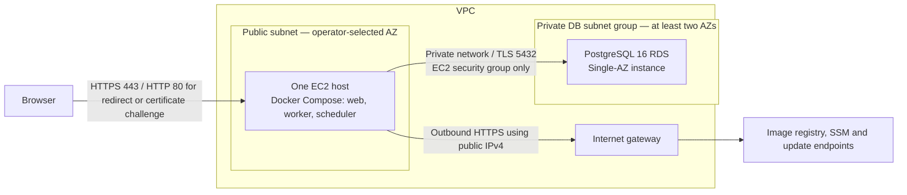

# AWS reference topology

This directory defines the selected EC2 + Compose reference and its network resources, plus opt-in EC2, private RDS, registry, runtime-secret access, deployment, observation and Valkey contracts. Its partial S3 backend is configured separately; the standalone `bootstrap/state-backend` root defines the reviewed bucket proposal. These are resource definitions, not an applied environment. Offline validation and application setup provision nothing. Start with the [AWS guide](../../docs/aws.md) for prerequisites, explicit choices, disabled activation and recovery limits.



One EC2 host runs the web, worker and scheduler containers. PHP-FPM, PostgreSQL, Redis and management ports stay private. Use SSM for administration; SSH is not a required public entry point. Redis remains optional and off by default; sessions and queues retain their database drivers. A container restart policy is not host or AZ redundancy.

The EC2 public subnet has an internet-gateway route and the instance has a public IPv4 address. This permits image pulls, SSM connectivity and package updates without a mandatory NAT Gateway. It does not authorize unrestricted inbound traffic. The web SG accepts HTTPS only from required `web_ingress_ipv4_cidrs`; `enable_http_ingress` defaults to false and enables only port 80 for a later redirect/challenge implementation. No SSH, Redis, FPM or administrative ingress exists. Web egress is TCP 80/443 for registry, SSM and package endpoints plus TCP 5432 to the database SG. The database SG has no initiated outbound rules; stateful responses remain permitted. VPC DNS resolver traffic is handled by AWS and cannot be filtered with SG rules. The default SG is emptied. ALB, ECS, Fargate and Kubernetes are outside this initial topology. See [internet-gateway requirements](https://docs.aws.amazon.com/vpc/latest/userguide/VPC_Internet_Gateway.html).

RDS has no public access. Its security group accepts PostgreSQL only from the EC2 security group in the VPC. Even Single-AZ RDS requires a DB subnet group covering at least two AZs; that group does **not** make the database Multi-AZ. Database credentials, TLS verification and a non-administrative application role belong to AWS-05/AWS-06. See [RDS VPC and subnet requirements](https://docs.aws.amazon.com/AmazonRDS/latest/UserGuide/USER_VPC.WorkingWithRDSInstanceinaVPC.html).

## Operator choices and limits

Region, domain, capacity, recovery and client CIDRs are required; only the HTTP ingress opt-in defaults to false; there are no region, instance, domain, capacity or budget defaults. `terraform.tfvars.json.example` is an intentionally incomplete placeholder, never an automatic variable file. Replace every placeholder and `null` capacity/recovery field deliberately. `cost_review.monthly_budget` may remain `null` to record that no ceiling has been approved; this does not mean zero cost and creates no AWS Budget. Enter no credentials, application keys or secret values here.

Input validation checks IPv4 prefix limits, subnet containment and overlap, basic shapes, positive capacities, explicit recovery objectives and nonzero backup retention. It does not check AWS service availability, instance compatibility, AMI minimum volume size, RDS storage limits, DNS ownership or affordability. Resource-specific validation follows in the corresponding issues. Synthetic test values are not deployable recommendations.

The host is a single point of failure for web, jobs and schedules. Single-AZ RDS has no standby failover; host or AZ incidents and database maintenance can cause downtime. The operator must accept these limits or commission a separate availability design. See [Multi-AZ standby behavior](https://docs.aws.amazon.com/AmazonRDS/latest/UserGuide/Concepts.MultiAZSingleStandby.html).

Before any deployment, review regional EC2, EBS and snapshots, RDS compute/storage/I/O/backups, public IPv4, registry storage, data transfer (including possible cross-AZ traffic), logs and secret-management costs. No price, workload fit or free-tier eligibility is assumed. Public IPv4 has a charge; avoiding NAT does not make networking free. Use the selected region and approved workload to calculate costs and record an owner/ceiling. See [VPC pricing](https://aws.amazon.com/vpc/pricing/).

## Recovery requirements

Choose automated-backup retention explicitly (1–35 days), RPO, RTO and the cadence of isolated restore rehearsals. Backups do not provide availability and the targets in this interface are not measured guarantees. A restore creates a new RDS instance; verify private networking, encryption, TLS, schema/data, application-role access and web/worker/scheduler recovery before an explicitly approved cutover. Also account for application-key/secret recovery and persistent file data separately from database backups. AWS-09 (#30) supplies the operational procedure and evidence. No restore is performed here. See [backup retention](https://docs.aws.amazon.com/AmazonRDS/latest/UserGuide/USER_WorkingWithAutomatedBackups.BackupRetention.html) and [snapshot restore semantics](https://docs.aws.amazon.com/AmazonRDS/latest/UserGuide/USER_RestoreFromSnapshot.html).

## Offline validation

With Terraform 1.10 or later (below 2.0), from the repository root:

```sh
terraform -chdir=infra/aws fmt -check -recursive
terraform -chdir=infra/aws init -backend=false -input=false -lockfile=readonly
terraform -chdir=infra/aws validate
terraform -chdir=infra/aws test
```

All test runs explicitly use `command = plan`; the application test files replace the AWS provider with `mock_provider`, require no AWS credentials and make no AWS requests. The standalone bootstrap tests use a mocked AWS provider and are also plan-only. Terraform tests otherwise default to `apply`, so preserve the explicit plan-only boundary when extending them. These checks validate the interface, planned port restrictions and static resource relationships, not live infrastructure, TLS termination or backups. See [Terraform test commands](https://developer.hashicorp.com/terraform/language/tests).

## Private PostgreSQL resource contract

`rds = null` leaves RDS unselected. Review `rds.tfvars.json.example` alongside the required network/database inputs; the placeholders and null fields cannot serve as production choices. The opt-in resource is PostgreSQL16 Single-AZ with the dedicated private subnet group/SG, gp3 encrypted with a selected regional KMS key, automated backups, a mandatory final snapshot and Terraform prevent_destroy. Deletion protection and minor-version updates are deliberate operator choices. Catalog data sources validate the selected regional version/class/storage/AZ and CA only during an explicitly authorized AWS plan; offline tests replace them with mocks. No RDS, SQL or AWS operation is performed by validation.

RDS manages the administrator password in Secrets Manager using a separately selected KMS key; Terraform reads only its ARN metadata. The administrator secret remains operator-only and must not be granted to the application EC2 role. The non-secret `database_connection` output selects a separate application username and `sslmode=verify-full`. After an approved database bootstrap, use `templates/rds-application-role.sql` with psql variables for the selected database and role. It creates a role with LOGIN but no superuser/create-db/create-role/replication/bypass-RLS privileges, granting CONNECT and public-schema USAGE/CREATE for native migrations. It refuses existing roles and a mismatched database. Terraform never invokes it. Set the role password through private interactive psql `\password`, and deliver that application credential through the approved runtime secret mechanism (#27); the SQL file never receives passwords.

The RDS parameter group requires TLS and avoids statement/error-statement logging. Obtain the reviewed regional/global root CA bundle from [AWS RDS certificate documentation](https://docs.aws.amazon.com/AmazonRDS/latest/UserGuide/UsingWithRDS.SSL.html), mount it read-only, and set `DB_SSLROOTCERT` to that path with `DB_SSLMODE=verify-full`, using the real RDS endpoint hostname. Laravel passes both options to the native PostgreSQL connector, including cached production configuration. Plan CA maintenance and managed-secret rotation explicitly; administrator rotation does not rotate the application role or APP_KEY. Database/application credentials and CA files require separate recovery procedures (#27/#30). No credential value is accepted by these Terraform inputs or output.

Offline catalog/port/TLS contract tests do not prove live RDS reachability, actual CA verification or a successful restore. The separate PostgreSQL16 role smoke verifies SQL privileges against a disposable container with no published ports, never an RDS instance.

## Application runtime secrets

The selected service is **Secrets Manager**, using one existing application secret per environment. Its JSON value contains only `APP_KEY` (canonical base64 encoding of 32 bytes), `DB_USERNAME` (the separately created RDS application role), `DB_PASSWORD`, and optionally `REDIS_PASSWORD`. An authorized operator creates the value through a private approved channel; this repository never generates, uploads or rotates it. The RDS-managed administrator secret is a different resource and remains operator-only. `runtime_secrets = null` grants no additional access. Opt-in inputs and outputs carry exact secret/KMS identifiers and the rotation owner, never values; no secret-version resource/data source, user-data fetch or build argument is installed.

Secrets Manager is chosen for the shared JSON credential boundary, version stages and native rotation integration. SSM standard parameters can avoid a secret storage charge but do not provide the same native credential rotation contract. Budget one stored application secret plus GetSecretValue requests and customer-managed KMS usage using the selected region's reviewed quote. A future rotation Lambda would add its own execution cost; none is configured here. Calculate storage rate + monthly reads / pricing request unit × request rate + KMS charges; the published pricing examples are not an assumed regional budget. Review [Secrets Manager pricing](https://aws.amazon.com/secrets-manager/pricing/) and [rotation mechanisms](https://docs.aws.amazon.com/secretsmanager/latest/userguide/rotating-secrets.html) before activation. There is no polling service or per-request AWS fetch.

The EC2 instance profile receives GetSecretValue on exactly the application ARN and KMS Decrypt on exactly its key, limited by ViaService and the secret ARN encryption context. An explicit Deny rejects GetSecretValue for every other secret, including the administrator secret, even if another identity policy grants it. Legacy grants to extra secrets/keys are refused. Terraform checks the RDS application username immediately and the administrator secret ARN relationship when its computed metadata becomes known; mock plans cannot prove that future AWS value. The application containers receive no AWS credentials or metadata-based read helper. Keep the existing IMDSv2 hop limit of one and the application's bridge-network boundary.

Prepare a reviewed public metadata file from `runtime-secrets.config.json.example` outside the checkout. On the approved host, install a reviewed AWS CLI v2 executable from the [official installation procedure](https://docs.aws.amazon.com/cli/latest/userguide/getting-started-install.html), verifying its signature/version; #25 intentionally installs only Docker/SSM and this helper does not download software. Python3 is required. Use the instance profile, never exported/static AWS keys or shared credential profiles: the helper strips AWS variables and disables shared config/credential files and legacy Boto config before invoking CLI2. Compose must be at least 2.30.0 for [env_file format: raw](https://docs.docker.com/reference/compose-file/services/#format).

Run the helper first without `--execute` to validate metadata offline. For an individually approved read on the host, invoke `python3 infra/aws/scripts/runtime_secrets.py --config /etc/template-runtime/metadata.json --output /etc/template-runtime/production.env --aws-cli /usr/local/bin/aws --execute`. The output directory must already be owned by the invoking host identity with mode 0700; the atomic file is 0600. Symlinks, hardlinks and permissive existing files are refused. Use this file only as Compose's service `env_file`, never as a shell source, Docker build context, tracked `.env`, CLI `--env-file` interpolation input or log/artifact. PHP/worker/scheduler/migration use raw parsing to preserve `$`, quotes and backslashes. Avoid printing `docker compose config`/inspect environments for real secrets. Mount the approved RDS CA read-only at the configured container path. Containers rebuild only their private cached configuration at startup; no image build, migration or seeding happens here.

APP_KEY remains stable for the environment lifetime and must be recoverable separately from the database backup. RDS administrator rotation does not rotate the application role. For application DB rotation, use an approved maintenance/drain window: stop new work, use the administrator's private interactive `psql \password` for the existing application role, update the existing application secret's AWSCURRENT version through the approved private operator channel while preserving APP_KEY, prepare the runtime file, then explicitly recreate PHP/worker/scheduler from their selected immutable images under the same Compose project. Allow the worker's configured 90-second graceful shutdown and keep one scheduler. Validate `/ready` and an authorized session before resuming traffic. A failed fetch/validation preserves the prior file; it cannot undo an already changed database password, so restore the matching DB credential/secret version through the same operator procedure before restart. Do not switch to a mismatched password version as a rollback. No automatic read, restart, DB mutation, secret version promotion or APP_KEY rotation is executed by this code. A requested key rotation needs a separate encrypted-data/session recovery plan.

Laravel's native env reader interprets reserved words such as `null` and removes one external pair of quotes. For these literal credentials/identifiers only, the helper supplies an additional pair retained by raw Compose and consumed once by Laravel; normal strings remain byte-for-byte OS values. Consume credentials through the existing Laravel config/env APIs, not a separate getenv-based application connector. The values recovered by cached configuration match the secret, including quotes, reserved words and whitespace. This encoding is why the file must use raw service env_file parsing.

Offline tests use a fake CLI and synthetic credentials. Terraform native mock plans check exact IAM and rejection cases; the source/plan guard rejects literal secrets (including HCL/JSON tfvars) and excessive IAM wildcards. A disposable production PHP container smoke verifies actual getenv plus cached native Laravel configuration in PHP/worker/scheduler/migration. These checks do not prove live IAM/Secrets Manager access, installed host CLI, RDS connectivity, a rotation or a recovery; those remain individually approved operator actions.

## Optional managed Valkey

`valkey = null` is the default: no cache subnet group, SG/rules, primary or endpoint is allocated. Existing database cache/session/queue defaults remain unchanged. Both Redis OSS and Valkey use the RESP protocol supported by the production PhpRedis client (6.3.0); this optional reference chooses only Valkey. AWS currently prices comparable Valkey provisioned nodes below Redis OSS and its VALKEY RBAC groups disable the unauthenticated default user. This is a reason to evaluate Valkey, not proof that this application needs managed cache. Review [engine comparison and regional pricing](https://aws.amazon.com/elasticache/pricing/) and [RBAC behavior](https://docs.aws.amazon.com/AmazonElastiCache/latest/dg/Clusters.RBAC.html) before any activation.

The selected AWS `replication_group` API is used for TLS/RBAC, with exactly **one primary**, cluster mode disabled, no replicas, failover, multi-AZ, sharding, global group or Horizon. It reuses the private subnets, accepts TCP 6379 only from the EC2 SG, and requires encrypted transit and storage. The named capacity/version/AZ, snapshot days and maintenance window are operator inputs, not a workload recommendation. Regional version/family/node compatibility is unverified offline. One primary can lose availability/data on maintenance or failure; opting sessions or queues into it requires an explicit recovery decision. Database queues remain the default durable queue choice.

Use a **pre-existing VALKEY user group** and an operator-managed password user. Before activation, the named authentication owner must verify the group engine, user membership, username, password authentication and reviewed ACL/prefix permissions in the selected account/region. These relationships are **UNKNOWN offline**. AWS provider 6.68 has no user-group datasource; its user datasource uses optional rather than computed output attributes, so mocked plans cannot reliably validate that relationship. No fake AWS metadata or invented datasource is used. Terraform creates/reads/rotates no cache user, group, password or secret value. `auth_token`/`passwords` would enter state; write-only arguments require Terraform 1.11 while this project supports 1.10.5. IAM tokens expire and require refresh per connection, so a static token in cached configuration is not substituted. See [provider schema](https://github.com/hashicorp/terraform-provider-aws/blob/v6.68.0/internal/service/elasticache/user_data_source.go), [write-only minimum version](https://developer.hashicorp.com/terraform/language/manage-sensitive-data/write-only) and [IAM auth lifetime](https://docs.aws.amazon.com/AmazonElastiCache/latest/dg/auth-iam.html).

The existing application secret from AWS-06 contains `REDIS_PASSWORD`, managed through its separately approved operator procedure. Add the optional public `valkey` object illustrated in `valkey-runtime.config.json.example` to the reviewed runtime metadata. Select `cache_store`, `session_driver` and `queue_connection` independently as `database` or `redis`; none switches the others. Runtime delivery requires the password, keeps it out of the `rediss://host:6379` URL, retains default DB 0/cache DB 1, and verifies TLS peer/certificate names with the image's trusted CA bundle. Secret encoding, private atomic writes and stable APP_KEY continue through the AWS-06 helper. Use the same prepared file for web/worker/scheduler/migration and explicitly recreate the approved services after an individually authorized update. No read, restart or provisioning occurs automatically.

Off means zero **additional** ElastiCache resources/cost, not zero topology cost. When enabled, budget one selected provisioned node's regional hourly rate × approved monthly hours, retained snapshots beyond included storage, data transfer/cross-AZ traffic and existing Secrets Manager reads/KMS charges. There is no replica or mandatory NAT cost; there is also no managed-cache availability guarantee. Keep the cost-review owner/ceiling current and justify the recurring cost with measured benefit. No live price quote, capacity fit, AWS plan, apply/destroy, provisioning or credentials read was performed.

Native mock plans exercise opt-in and rejection contracts without AWS; some resource IDs remain unknown until apply, so they cannot prove live SG/endpoint assignments. A disposable production PHP/Valkey TLS fixture exercises cache TTL/invalidation, session persistence and real queue reservation/processing/deletion separately, with wrong-password, mismatched-certificate and plaintext connections required to fail closed. It uses generated local credentials/certificates, an internal Docker network and scoped cleanup; it is not an ElastiCache deployment or live IAM/RBAC audit.
